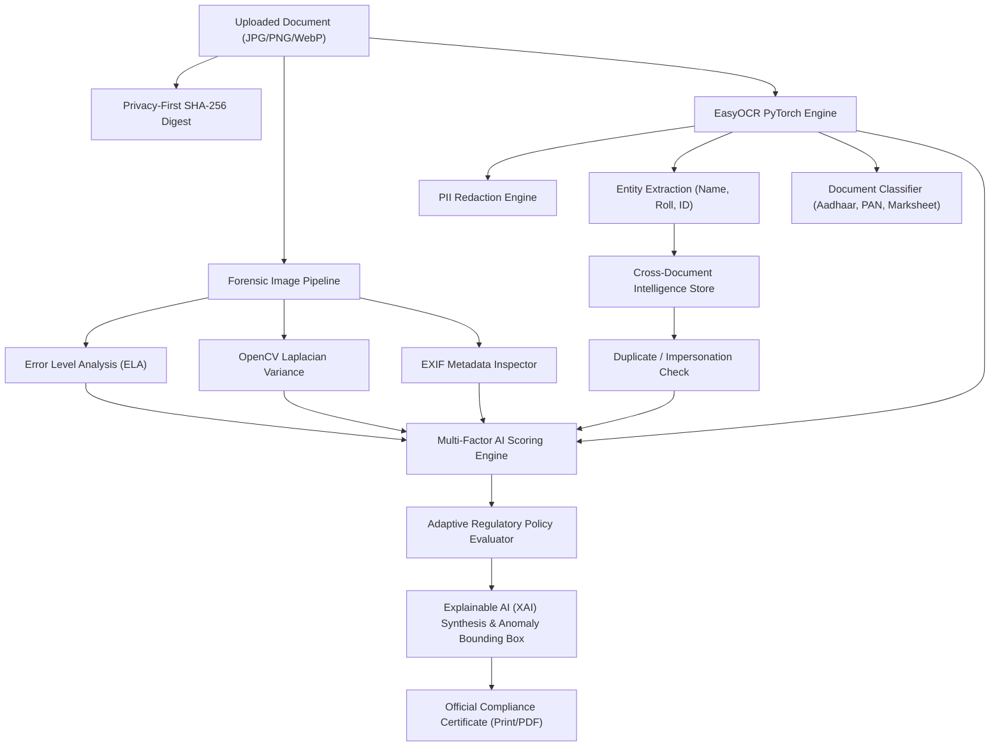

# AVÉRION - AI Application Validation & Compliance Platform

[](https://sih.gov.in)
[](https://fastapi.tiangolo.com)
[](https://pytorch.org)
[](https://opencv.org)
[](LICENSE)

> **Smart India Hackathon 2026 • Problem Statement: SIH26261**  
> AI-powered automated document forgery detection, cross-document intelligence, and regulatory compliance verification suite.

---

## 🌟 Key Capabilities (The 5 SIH Core Pillars)

### 1. 🔍 Cross-Document Intelligence & Consistency Checking
* Extracts applicant entities (Roll Number, Reg No, Applicant Name, Year) from the OCR stream.
* Compares incoming credentials against a centralized cryptographic ledger to catch **duplicate certificate submissions**.
* Detects **impersonation fraud** when the same credential or roll number is submitted under conflicting applicant identities.

### 2. 🧠 Explainable AI (XAI) for Transparent Verification
* Transparent **5-Vector Factor Breakdown** for every decision:
  * Visual ELA Uniformity ($25\%$)
  * Edge & Texture Sharpness ($20\%$)
  * EasyOCR Character Readability ($25\%$)
  * Metadata & Software Provenance ($15\%$)
  * Regulatory & Identity Consistency ($15\%$)
* Generates human-readable audit justifications and projects a **real-time red anomaly bounding box** over suspicious, altered, or spliced regions.

### 3. 🛡️ Multi-Factor AI Risk Scoring
* Replaces static clipping with a true composite weighted mathematical formula.
* Dynamically classifies submissions into **Verified (Low Risk)**, **Review (Manual Queue)**, or **Flagged (High Risk)** based on forensic signals.

### 4. ⚖️ Adaptive Regulatory Compliance Engine
* Supports multi-scheme regulatory rules that dynamically reconfigure verification criteria:
  * 🏛️ **General Identity Scheme**: Standard national template validation.
  * 🎓 **National Merit Scholarship**: Validates minimum 60% / First Class distinction and recognized board authorization.
  * 📋 **EWS & Income Subsidy**: Enforces authorized Revenue/Tehsildar seals and income ceiling clauses ($< \text{₹2.5 Lakhs}$).

### 5. 🔒 Privacy-First Document Verification
* **Automated PII Redaction**: Masks sensitive citizen credentials in real-time:
  * 12-digit Aadhaar Numbers $\rightarrow$ `XXXX-XXXX-1234`
  * 10-digit PAN Numbers $\rightarrow$ `ABCDE****F`
  * Mobile Numbers $\rightarrow$ `XXXXXX1234`
* **Zero-Knowledge SHA-256 Digest**: Computes a cryptographic tamper-evident hash for audit verification without persisting unencrypted citizen PII.

---

## 🏗️ Architecture



---

## 🚀 Quick Start (Local Setup)

### Prerequisites
* Python 3.9+ 
* Git

### 1. Clone & Setup
```bash
git clone https://github.com/YOUR_USERNAME/averion-sih26261.git
cd averion-sih26261
```

### 2. Start Backend & UI (One-Click)
* **Windows**: Double-click `start_averion.bat`
* **Linux / Mac**:
  ```bash
  cd backend
  python3 -m venv .venv
  source .venv/bin/activate
  pip install -r requirements.txt
  uvicorn main:app --host 0.0.0.0 --port 8000 --reload
  ```
Open `http://localhost:8000` in your browser.

---

## 🌐 Free Online Deployment

### Option A: Render (Free Cloud Hosting)
1. Fork or push this repository to your GitHub.
2. Sign in to [Render.com](https://render.com) and click **New Web Service**.
3. Select your repository.
4. Set:
   * **Root Directory**: `backend`
   * **Build Command**: `pip install -r requirements.txt`
   * **Start Command**: `uvicorn main:app --host 0.0.0.0 --port $PORT`
5. Click **Deploy**. Your app will be live at `https://your-app.onrender.com`!

### Option B: Hugging Face Spaces (Free CPU/GPU Docker)
1. Create a new Space on [Hugging Face](https://huggingface.co/spaces) (Docker or Gradio SDK).
2. Push this repo. Fast and free PyTorch execution.

---

## 📡 API Endpoints

| Method | Endpoint | Description |
| :--- | :--- | :--- |
| `GET` | `/` | Serves the full dark-mode AVÉRION Web Dashboard |
| `GET` | `/api/health` | Healthcheck and active feature status |
| `GET` | `/api/applications` | Returns ledger of analyzed applications |
| `POST` | `/api/verify` | Multipart upload for forensic verification |

---

## 📜 License
Developed for Smart India Hackathon 2026 (SIH26261). MIT License.
